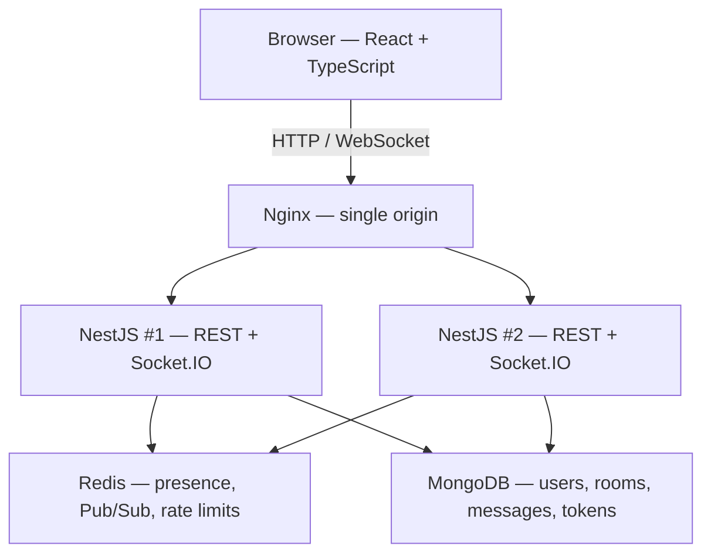

# Pulse Chat

A production-shaped real-time chat platform: persistent rooms, Socket.IO messaging,
and an API that is designed to run as more than one process. Redis Pub/Sub is the
cross-instance event bus; MongoDB holds durable data; Nginx is the single browser
origin.

The engineering contract is [`SPECIFICATION.md`](./SPECIFICATION.md). This README
describes what the repository actually implements.

## Contents

1. [Overview](#1-overview)
2. [Key features](#2-key-features)
3. [Architecture](#3-architecture)
4. [Technology stack](#4-technology-stack)
5. [Repository structure](#5-repository-structure)
6. [Local setup](#6-local-setup)
7. [Environment configuration](#7-environment-configuration)
8. [Docker setup](#8-docker-setup)
9. [Production architecture](#9-production-architecture)
10. [Authentication](#10-authentication)
11. [WebSocket architecture](#11-websocket-architecture)
12. [Redis presence](#12-redis-presence)
13. [Redis Pub/Sub](#13-redis-pubsub)
14. [MongoDB data model](#14-mongodb-data-model)
15. [Testing](#15-testing)
16. [Security](#16-security)
17. [Performance and scaling](#17-performance-and-scaling)
18. [API documentation](#18-api-documentation)
19. [Demo](#19-demo)
20. [Architecture decisions](#20-architecture-decisions)
21. [Future improvements](#21-future-improvements)

---

## 1. Overview

Pulse Chat is a TypeScript monorepo (`@pulse-chat/web` + `@pulse-chat/api` +
`@pulse-chat/shared`) built to show how a chat product stays correct when HTTP
and WebSocket share the same services, and when two Nest processes do not share
an in-memory Socket.IO room.

The browser talks to one origin. Nginx terminates that origin and proxies REST
and `/socket.io` to Nest. Each API process owns its own sockets. Durable writes
go to MongoDB; presence, rate limits, and realtime fan-out go to Redis. Adding
a replica does not require the Socket.IO Redis adapter — it requires the same
`MONGODB_URI` and `REDIS_URL`, and a unique process id (already the default).

## 2. Key features

What ships in this codebase:

- **Accounts** — register, login, logout, access/refresh JWTs, profile and avatar
- **Rooms** — public, private, and 1:1 direct rooms; owner / moderator / member
- **Messaging** — send, edit, soft-delete, replies, reactions, `@mentions`, search
- **Realtime** — Socket.IO `message:send`, typing, presence, notification push
- **History** — cursor-paginated messages (default 50, max 100); virtualized list
- **Unread** — membership `lastReadMessageId` plus live increments for rooms
  without a loaded cache
- **Attachments** — JPEG, PNG, GIF, WebP, PDF, plain text; 10 MiB; magic-byte
  type detection; downloads require membership and a Bearer token
- **Notifications** — mention, reply, direct message, room invitation
- **Theme** — light/dark, persisted
- **Ops** — structured JSON logs, `/health` probes, OpenAPI in non-production,
  GitHub Actions (lint, typecheck, unit, integration, build, Playwright, images)

Not implemented: voice/video, end-to-end encryption, S3 object storage, native
mobile clients, an admin console (a `USER` / `ADMIN` field exists on the user
document; nothing in the API grants extra rights from `ADMIN`).

## 3. Architecture



Socket.IO `socket.join(roomId)` is **per process**. A client on instance 1 and a
client on instance 2 are never in the same in-memory room. After MongoDB
commits, `RealtimeMessageBroadcastService` emits locally **and awaits** Redis
`PUBLISH`. Remote instances ignore envelopes whose `originInstanceId` matches
their own, then `server.to(roomId).emit` to sockets that actually joined there.

REST and WebSocket share the same application services. A message created with
`POST /api/rooms/:id/messages` is the same document as `message:send`.

```text
AppModule
 ├── AppConfigModule          env → typed config, APP_INSTANCE_ID
 ├── InfrastructureModule     MongoDB, Redis, logging, HTTP errors, health
 ├── RateLimitModule          Redis fixed-window counters (global)
 ├── AuthModule               register / login / refresh / logout
 ├── UsersModule              profiles, last-seen, avatar
 ├── RoomsModule              rooms, membership, read cursor, eviction
 ├── MessagesModule           history, edits, deletes, reactions, search
 ├── AttachmentsModule        upload / download / link to messages
 ├── NotificationsModule      persist + personal socket room
 └── RealtimeModule
      ├── RealtimeGateway
      ├── PresenceModule
      └── RealtimeBroadcastModule   Redis bus + local Socket.IO emit
```

Business code depends on repository interfaces (`MessageRepository`,
`PresenceStore`, `RealtimeEventPublisher`). Mongoose and ioredis stay behind
those interfaces.

Frontend state follows a hard split: **Zustand** owns the session, socket
connection, presence, typing, unread overlays, and room chrome; **TanStack Query**
owns REST resources. Socket events patch the query cache. Logout bumps a session
generation so an in-flight refresh cannot write tokens back.

## 4. Technology stack

| Layer    | Choice                                                                                                   | Why it is here                                                                     |
| -------- | -------------------------------------------------------------------------------------------------------- | ---------------------------------------------------------------------------------- |
| Language | TypeScript 6, `strict`, lint `--max-warnings 0`, no `any`                                                | Shared contracts stay honest across the wire                                       |
| Frontend | React 19, Vite, React Router, Zustand, TanStack Query, Socket.IO client, Tailwind, React Hook Form + Zod | Session/UI vs server cache are separate problems                                   |
| Backend  | NestJS 11, Socket.IO, `@nestjs/jwt` (not Passport), Mongoose, ioredis, Zod pipes                         | JWT verification is a small custom `AuthGuard`; Zod is the same schemas as the SPA |
| Data     | MongoDB 8 (durable), Redis 8 (ephemeral)                                                                 | Chat history is document-shaped; presence must expire                              |
| Edge     | Nginx 1.30                                                                                               | One origin for CORS, cookies, and WebSocket upgrade                                |
| Tooling  | pnpm workspaces, Turborepo, ESLint 10 flat config, Prettier, Vitest, Playwright, GitHub Actions          | One command (`pnpm verify`) is lint + types + tests + build                        |

`packages/shared` is ESM-only and platform-neutral (no `window`, no `process`).
The API compiles to CommonJS and `require()`s that ESM, which needs Node
`^22.13.0 || >=24.0.0`.

## 5. Repository structure

```text
pulse-chat/
├── apps/
│   ├── api/                 NestJS: REST, Socket.IO, MongoDB, Redis
│   └── web/                 React SPA (Vite)
├── packages/
│   ├── shared/              Types, Zod schemas, constants (imported by name)
│   ├── config/              Shared tsconfig
│   └── eslint-config/       Shared ESLint flat configs
├── e2e/                     Playwright critical path
├── infrastructure/
│   ├── docker/              Dev and production images
│   └── nginx/               Dev proxy, prod proxy, SPA static config
├── docs/                    Architecture, API, security, deployment
└── .github/workflows/       CI
```

Allowed imports: both apps → `@pulse-chat/shared`. Apps never import each other.
Nothing imports an app. ESLint enforces package-name imports.

## 6. Local setup

**Prerequisites:** Node `^22.13.0 || >=24.0.0` (see `.nvmrc`), pnpm `>=11`,
Docker (for MongoDB/Redis or the full stack).

```bash
pnpm install
pnpm verify                 # lint + typecheck + Vitest + build
```

**Host apps, container data stores** (fastest loop on Windows/macOS; Docker bind
mounts do not deliver `node --watch` events to the API):

```bash
docker compose up -d mongodb redis
pnpm dev                    # API :3000, Vite :5173
```

Point the browser at the Vite origin, or put Nginx in front (see Docker below)
so `/api` and `/socket.io` share the page origin.

```bash
pnpm --filter @pulse-chat/api test
pnpm --filter @pulse-chat/web dev
```

| Command                 | What it runs                                    |
| ----------------------- | ----------------------------------------------- |
| `pnpm dev`              | Watch mode for workspace packages               |
| `pnpm build`            | Production builds                               |
| `pnpm typecheck`        | `tsc --noEmit` per package                      |
| `pnpm lint`             | ESLint, zero warnings                           |
| `pnpm test`             | Vitest unit + API integration                   |
| `pnpm test:unit`        | Unit only                                       |
| `pnpm test:integration` | Nest + in-memory MongoDB (and Redis stand-in)   |
| `pnpm test:e2e`         | Playwright (needs MongoDB + Redis on localhost) |
| `pnpm format`           | Prettier                                        |

## 7. Environment configuration

Application code never reads `process.env` ad hoc. `@pulse-chat/shared` parses
a typed `AppConfig`. Production **refuses** the development JWT placeholders
and requires secrets ≥ 32 characters.

Copy [`.env.example`](./.env.example) to `.env` only to override defaults. A
clean checkout starts without `.env`: development JWT placeholders are applied
automatically.

| Variable                                           | Role                                                |
| -------------------------------------------------- | --------------------------------------------------- |
| `NODE_ENV`                                         | `development` \| `test` \| `production`             |
| `PORT`                                             | API listen port (default `3000`)                    |
| `MONGODB_URI`                                      | Durable store                                       |
| `REDIS_URL`                                        | Presence, Pub/Sub, rate limits                      |
| `JWT_ACCESS_SECRET` / `JWT_REFRESH_SECRET`         | Separate HS256 keys                                 |
| `JWT_ACCESS_EXPIRES_IN` / `JWT_REFRESH_EXPIRES_IN` | Default `15m` / `30d`                               |
| `CORS_ORIGIN`                                      | Single allowed browser origin                       |
| `FILE_STORAGE_PROVIDER`                            | Only `local` is implemented                         |
| `FILE_STORAGE_PATH`                                | Disk directory for uploads                          |
| `RATE_LIMIT_*`                                     | Fixed-window budgets (see [Security](#16-security)) |

The SPA uses optional `VITE_API_BASE_URL` and `VITE_WS_URL`. Empty API base
means same-origin relative `/api/...` paths — the Nginx topology.

Production Compose interpolates `PULSE_*` variables from
[`.env.production.example`](./.env.production.example) (Mongo/Redis auth, JWT,
public origin). Those demo values are not real secrets.

## 8. Docker setup

```bash
docker compose up
```

Open <http://localhost:8080>. Nginx is the only published HTTP port the browser
needs. Containers address each other by **service name** (`mongodb`, `redis`,
`api`, `web`), never `localhost`.

| Service     | Role                                                    | Host bind       |
| ----------- | ------------------------------------------------------- | --------------- |
| `nginx`     | Single origin; upgrades WebSocket                       | 127.0.0.1:8080  |
| `web`       | Vite                                                    | 127.0.0.1:5173  |
| `api`       | Nest watch mode                                         | 127.0.0.1:3000  |
| `workspace` | `pnpm install` + compile `@pulse-chat/shared` (no race) | —               |
| `mongodb`   | Unauthenticated, loopback only, `mongodb-data` volume   | 127.0.0.1:27017 |
| `redis`     | Unauthenticated, loopback only, **no persistence**      | 127.0.0.1:6379  |

Redis runs `--save "" --appendonly no` and `noeviction`: presence and rate-limit
keys must not resurrect after a restart, and memory pressure must fail loudly
rather than evicting sessions.

A `workspace` service owns install and the shared package build so `api` and
`web` do not race on `packages/shared/dist`. Named volumes keep Linux
`node_modules` from being shadowed by the host bind mount.

OpenAPI (non-production): <http://localhost:8080/api/docs> through Nginx, or
<http://127.0.0.1:3000/api/docs> on the API port.

## 9. Production architecture

```bash
docker compose -f docker-compose.prod.yml config
docker compose -f docker-compose.prod.yml up --build
```

Still <http://localhost:8080>, but `/` is compiled static assets and `/api` plus
`/socket.io` are `least_conn` across **`api-1` and `api-2`**. Response header
`X-Pulse-Instance` names the process. Sticky sessions are unnecessary: Socket.IO
is websocket-only, and events cross instances on Redis.

```text
browser → nginx :8080
            ├─ /              web (static SPA)
            ├─ /api, /health  api-1 | api-2
            └─ /socket.io     api-1 | api-2
                 │
                 ├─ frontend network: nginx, web, both APIs
                 └─ backend network:  both APIs, MongoDB (auth), Redis (requirepass)
```

MongoDB and Redis are **not** published to the host. Both API containers mount
the same `api-storage` volume so an upload handled on `api-1` can be downloaded
on `api-2`. Processes run as non-root `node`, `no-new-privileges`, 20s
`SIGTERM` grace, Nest shutdown hooks.

This compose file is HTTP on loopback. TLS belongs in front of Nginx before
anything is exposed beyond localhost.

Cross-instance check (after `pnpm install`):

```bash
node infrastructure/docker/verify-prod-stack.mjs
```

Details: [`docs/deployment.md`](./docs/deployment.md).

## 10. Authentication

Passwords are bcrypt (cost 12). Login always hashes against a real or dummy
hash so unknown emails do not short-circuit on timing.

Access and refresh tokens are **separate HS256 JWTs** (`type: access` vs
`type: refresh`), verified with an algorithm allowlist so `alg: none` and
cross-token use fail. Access tokens are stateless (valid until expiry). Refresh
tokens are stored as SHA-256 hashes in MongoDB (`refresh_tokens`), keyed by
`jti` and `familyId`.

Rotation is claim-then-issue: presenting an already-rotated token after a 10s
grace window revokes the **family** (reuse = theft). Concurrent refresh of the
same token inside the window is a lost race: the loser is rejected, the new
token stays valid. Logout revokes the presented refresh token only; other
devices keep their families.

The SPA keeps both tokens in `localStorage` and sends `Authorization: Bearer`.
REST `401` (except credential endpoints) single-flights `POST /api/auth/refresh`.
`resetClientState` increments a session generation first so a refresh that
finishes after logout cannot restore the previous session. Socket `UNAUTHORIZED`
uses the same refresh path. Room subscriptions survive access-token reconnect;
a full disconnect on logout clears them.

This is **not** cookie/httpOnly session auth. See [Future improvements](#21-future-improvements).

## 11. WebSocket architecture

Path `/socket.io`, handshake `auth.token` = access JWT. Failed handshake →
Socket.IO `connect_error`. Application errors after connect → `error`
`{ code, message }` with the same codes as REST (`NOT_A_MEMBER`,
`TOO_MANY_REQUESTS`, …).

| Client → server                | Authorization                                          |
| ------------------------------ | ------------------------------------------------------ |
| `room:join` / `room:leave`     | Member for join; authenticated for leave               |
| `message:send`                 | Member; shares the HTTP message rate-limit bucket      |
| `typing:start` / `typing:stop` | Member; own Redis key, same numeric budget as messages |

Edits, deletes, reactions, and read cursors are REST, then broadcast.

Room events go to sockets that joined that Socket.IO room. Presence is
**global** (every authenticated socket on the instance). Notifications go to
personal room `user:{userId}`. Typing is room-scoped, ephemeral (not in MongoDB),
and the origin socket uses `socket.to(roomId)` so the typer is not echoed.

`clientMessageId` is unique per `(roomId, authorId)` so retries do not duplicate
messages.

Leaving or being removed via REST kicks matching sockets (`socket.leave` +
`room:left`) and publishes `internal:member-removed` so other API processes
drop the same user. Re-join after a kick uses `socket.rooms.has`, not stale
in-memory subscription tracking.

Event catalogue: [`docs/websocket-events.md`](./docs/websocket-events.md).

## 12. Redis presence

Presence is Redis, not MongoDB. A user is online while at least one session key
exists, including sockets on other processes.

| Key                               | Value                              |
| --------------------------------- | ---------------------------------- |
| `presence:session:{socketId}`     | user id (TTL)                      |
| `presence:user:{userId}:sessions` | set of socket ids                  |
| `presence:user:{userId}`          | `{ status, lastSeen, instanceId }` |

TTL is 45s; the process that owns the socket heartbeats every 15s. First
transition to online publishes `user:online`; last session gone publishes
`user:offline`. `lastSeenAt` is also persisted on the user document for
profiles.

The gateway **awaits** connect/disconnect so Redis and Pub/Sub update before
the handler returns. Multi-tab is one user, many session keys.

## 13. Redis Pub/Sub

The Socket.IO Redis adapter was rejected: it would re-emit every
`server.to(roomId).emit` on every instance and is easy to loop. Pulse Chat
publishes an explicit envelope on dedicated channels:

| Channel                       | Events                                |
| ----------------------------- | ------------------------------------- |
| `pulse:realtime:message`      | `message:new` / `updated` / `deleted` |
| `pulse:realtime:reaction`     | `reaction:added` / `removed`          |
| `pulse:realtime:presence`     | `user:online` / `offline`             |
| `pulse:realtime:notification` | `notification:new`                    |
| `pulse:realtime:typing`       | `typing:started` / `stopped`          |
| `pulse:realtime:membership`   | `internal:member-removed`             |

```json
{
  "version": 1,
  "event": "message:new",
  "originInstanceId": "hostname:pid:uuid",
  "occurredAt": "2026-08-18T12:00:00.000Z",
  "roomId": "…",
  "userId": "…",
  "payload": {}
}
```

Each process uses a **dedicated subscriber connection** (a Redis connection in
subscribe mode cannot run ordinary commands). Feature modules depend on
`RealtimeEventPublisher` / `RealtimeEventSubscriber`, not ioredis.

Publish is awaited on the write path so a client that disconnects immediately
does not drop remote delivery, and so tests can assert on the remote socket
without racing fire-and-forget `PUBLISH`.

Cross-instance coverage:
`apps/api/src/realtime/realtime-multi-instance.gateway.spec.ts` — two Nest
apps, two Socket.IO servers, **one** shared Redis stand-in.

## 14. MongoDB data model

Standalone MongoDB (no replica set, so no multi-document transactions). Direct-room
create rolls back memberships and the room if the second insert fails. Indexes
are created by initializers next to each schema.

| Collection          | Purpose                                                                               | Notable indexes                                                                                             |
| ------------------- | ------------------------------------------------------------------------------------- | ----------------------------------------------------------------------------------------------------------- |
| `users`             | Account; `passwordHash` is `select: false`                                            | unique email, unique username                                                                               |
| `refresh_tokens`    | Hashed refresh JWTs + family                                                          | unique `jti` / `tokenHash`; TTL on `expiresAt`                                                              |
| `rooms`             | `PUBLIC` / `PRIVATE` / `DIRECT`                                                       | `type`; sparse unique `directKey`                                                                           |
| `room_members`      | Role, `lastReadMessageId`                                                             | unique `(roomId, userId)`                                                                                   |
| `messages`          | Content, `clientMessageId`, optional reply, attachment refs, `editedAt` / `deletedAt` | `(roomId, createdAt, _id)` for cursors; unique `(roomId, clientMessageId, authorId)`; text index for search |
| `message_reactions` | One emoji per user per message                                                        | unique `(messageId, userId, emoji)`                                                                         |
| `attachments`       | Metadata + `storageKey`; bytes on disk                                                | unique `storageKey`                                                                                         |
| `notifications`     | `mention` / `reply` / `direct_message` / `room_invitation`                            | unique `(userId, type, referenceId, actorId)`                                                               |

Messages store attachment **ids**, not blobs. Soft-deleted messages keep a row
with `deletedAt` and redacted content on the DTO. Public rooms are listable
without membership; reading and writing always require membership.

## 15. Testing

| Layer           | How                                                                                          |
| --------------- | -------------------------------------------------------------------------------------------- |
| Shared          | Vitest on Zod schemas and parsers                                                            |
| API unit        | Services with fakes; Redis Lua; presence store                                               |
| API integration | Nest + `mongodb-memory-server`; HTTP via supertest; Socket.IO clients                        |
| Multi-instance  | Two Nest apps, shared ioredis-mock, real Pub/Sub path                                        |
| Web             | Vitest + Testing Library (hooks, cache sync, socket service)                                 |
| E2E             | Playwright: register, login, public room, typing, unread, notifications, private-room denial |

API Vitest splits **unit** vs **integration** by filename (controllers, gateways,
mongoose, `*.multi-instance.spec.ts` boot Nest). Integration uses one worker on
Windows so memory-server does not start many `mongod` processes.

E2E starts MongoDB/Redis via Compose if ports 27017/6379 are down, builds the
API, and drives Chromium against dedicated ports (API 3100, Vite 5174).

```bash
docker compose up -d mongodb redis
pnpm --filter @pulse-chat/e2e exec playwright install chromium
pnpm test:e2e
```

CI (`.github/workflows/ci.yml`): format, lint, typecheck, unit, integration,
build, Playwright with Mongo/Redis services, production image build. No deploy
job and no repository secrets for this workflow.

## 16. Security

Threat model: [`docs/security.md`](./docs/security.md) and specification §64.

- **Brute force** — IP rate limits on login/register/refresh/logout (Redis
  `INCR` + `EXPIRE` in one Lua script so two instances cannot double the budget)
- **Token theft / replay** — hashed refresh tokens, family revocation on reuse
- **IDOR** — membership checks on REST, Socket.IO join, search, and file I/O
- **Unauthorized room sockets** — REST leave/remove evicts Socket.IO rooms on
  every instance
- **XSS** — React text nodes, not HTML; production SPA CSP and related headers
- **Uploads** — magic bytes, no SVG, UUID storage keys, membership-gated GET,
  `Content-Disposition` inline vs attachment by type
- **Flooding** — shared message bucket for HTTP and `message:send`; typing has
  its own key; 10 MiB body cap aligned with Nginx `client_max_body_size`
- **Injection** — Zod at the edge; text search query sanitization
- **Transport** — single CORS origin; Helmet on the API; `trust proxy` = 1
  behind Nginx so rate-limit IPs are clients, not the proxy

Residual risk: refresh tokens in `localStorage` if XSS is ever introduced. CSP
is the compensating control in the production SPA image.

## 17. Performance and scaling

Targets in the spec (1000 concurrent sockets, 100 messages/s) are design goals,
not measured SLAs.

| Concern     | Mechanism                                                               |
| ----------- | ----------------------------------------------------------------------- |
| HTTP        | Any healthy API replica; Nginx `least_conn`                             |
| WebSocket   | One socket per instance; fan-out via Redis, not a Socket.IO adapter     |
| History     | Compound cursor `(createdAt, _id)`; never load a whole room             |
| UI          | `@tanstack/react-virtual` for the transcript                            |
| Presence    | TTL keys; heartbeat rather than polling MongoDB                         |
| Rate limits | O(1) Redis counters with TTL; restart of ephemeral Redis resets windows |
| Logs        | JSON in production; secrets and message bodies stripped                 |

`APP_INSTANCE_ID` is `hostname:pid:short-uuid`. A new replica only needs the
shared URIs and that unique id.

MongoDB is standalone: no change streams and no multi-document transactions.
Horizontal data scaling is not in this compose file.

## 18. API documentation

- Human-readable REST notes: [`docs/api.md`](./docs/api.md)
- OpenAPI UI (non-production only): **`/api/docs`** (Swagger, Bearer auth)
- Socket events: [`docs/websocket-events.md`](./docs/websocket-events.md)
- Errors: `{ statusCode, code, message }` on HTTP; `{ code, message }` on
  Socket.IO `error`

Health (no `/api` prefix): `/health`, `/health/readiness` (Mongo + Redis),
`/health/liveness`. Production Nginx proxies `/health`; the dev Nginx file
proxies `/api/` and `/socket.io/` only — hit `:3000` for probes in that topology.

## 19. Demo

No product screenshots are checked into git. The working UI is the authenticated
workspace at **`/app`** (the marketing home page is still a short entry screen).

```bash
docker compose up
# http://localhost:8080  → Register → Open chat
```

| Surface          | Route                    | Behaviour                                                 |
| ---------------- | ------------------------ | --------------------------------------------------------- |
| Register / login | `/register`, `/login`    | Zod + React Hook Form; session in Zustand (`persist`)     |
| Workspace        | `/app`, `/app/rooms/:id` | Room list, virtualized transcript, member panel, composer |
| Settings         | `/settings`              | Display name, username, bio, avatar, theme, logout        |
| Public profile   | `/profile/:username`     | No email                                                  |

In the workspace you can create public/private/direct rooms, join public rooms,
send and edit messages, reply, react, attach files, search, watch presence and
typing, and receive mention/reply/DM/invite notifications. Unread badges update
for rooms you are not viewing. Private rooms reject non-members (covered in E2E).

To capture stills for a portfolio: run the stack, walk the E2E path with two
browsers, and save images yourself (for example under `docs/screenshots/`).

## 20. Architecture decisions

Formal records live in [`docs/decisions/`](./docs/decisions). The decisions
encoded in code:

1. **MongoDB for chat** — rooms, messages, and memberships are documents with
   compound indexes; a SQL schema would fight pagination and sparse `directKey`.
2. **Redis Pub/Sub, not the Socket.IO adapter** — explicit envelopes, origin
   filtering, and channels that match product events (including membership
   eviction). Adapter semantics would couple fan-out to Socket.IO’s room table.
3. **Socket.IO rather than raw WebSockets** — handshake auth, reconnection, and
   named events without inventing a framing protocol. Transport is websocket-only.
4. **Cursor pagination** — `(createdAt, _id)` is stable under inserts; offset
   pagination would skip or duplicate under live writes.
5. **Zustand + TanStack Query** — auth and ephemeral realtime (typing, presence)
   are not REST resources; rooms and history are. Mixing them in one store
   duplicates server state.
6. **Shared Zod package** — one schema for HTTP bodies, Socket.IO payloads, and
   the SPA. The API is the authority; the client uses the same numbers for UX.
7. **Local disk for files in this repo** — `FILE_STORAGE_PROVIDER=s3` is parsed
   and then rejected at startup. Compose shares a volume between API replicas
   instead of pretending object storage exists.
8. **Ephemeral Redis** — presence and rate limits must not survive a restart as
   ghosts; `noeviction` avoids silent online/offline lies.

## 21. Future improvements

Honest gaps, not a roadmap promise:

- **HttpOnly refresh cookies** — would shrink XSS impact; it is a different
  auth strategy than Bearer-in-`localStorage`.
- **S3 (or equivalent)** — config key exists; no adapter. Needed before more
  than one host without a shared volume.
- **MongoDB replica set** — unlocks transactions (attachment + message in one
  commit) and change streams if they become necessary.
- **TLS on the edge** — production compose is HTTP on loopback by design.
- **Room-scoped presence** — today `user:online` / `user:offline` go to every
  socket on the instance (specified that way).
- **ADMIN** — stored, unused. Do not treat it as an authorization model.
- **Landing copy** — `/` still reads like a foundation page; `/app` is the product.
- **Measured load** — no k6/Gatling suite against the 1000-connection target.

---

## Further reading

| Document                                                 | Topic                                 |
| -------------------------------------------------------- | ------------------------------------- |
| [`SPECIFICATION.md`](./SPECIFICATION.md)                 | Product and engineering contract      |
| [`AGENTS.md`](./AGENTS.md)                               | Workspace invariants for contributors |
| [`docs/architecture.md`](./docs/architecture.md)         | Multi-instance realtime               |
| [`docs/api.md`](./docs/api.md)                           | REST routes as implemented            |
| [`docs/websocket-events.md`](./docs/websocket-events.md) | Socket.IO events and Redis bus        |
| [`docs/security.md`](./docs/security.md)                 | Threat model and controls             |
| [`docs/observability.md`](./docs/observability.md)       | Logs, redaction, health               |
| [`docs/deployment.md`](./docs/deployment.md)             | Compose, CI, GitHub settings          |
| [`docs/decisions/`](./docs/decisions)                    | Architecture decision records         |
